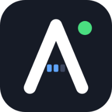
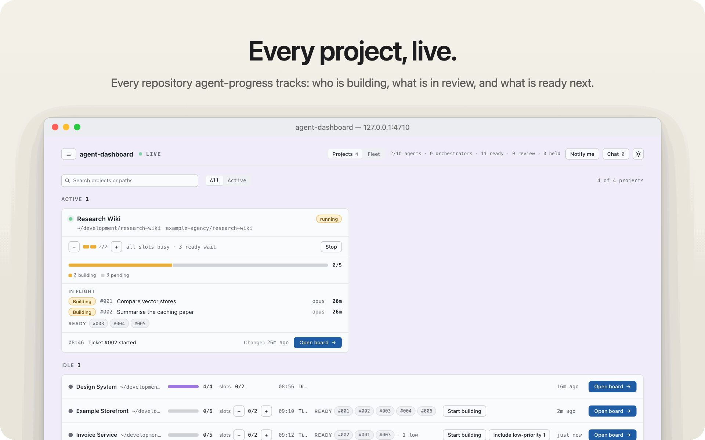
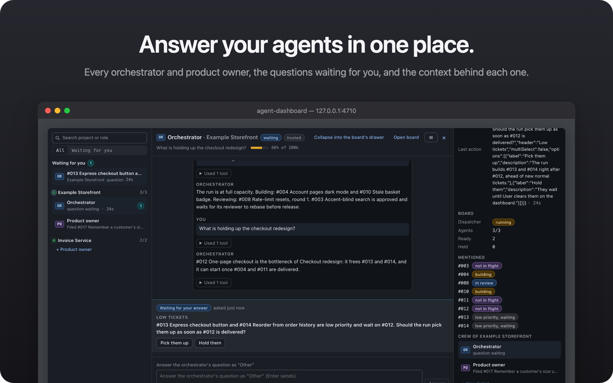
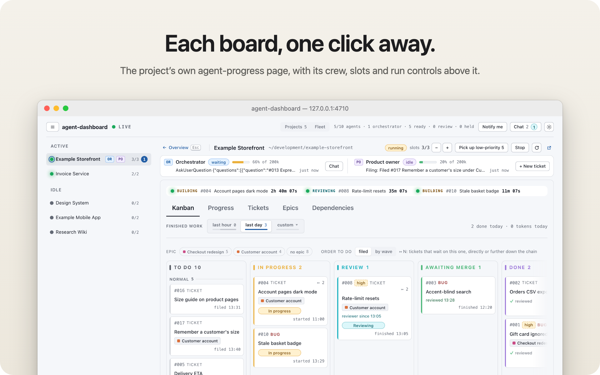
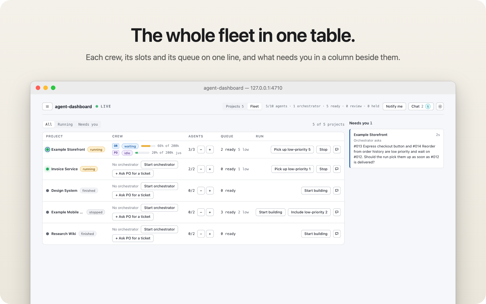
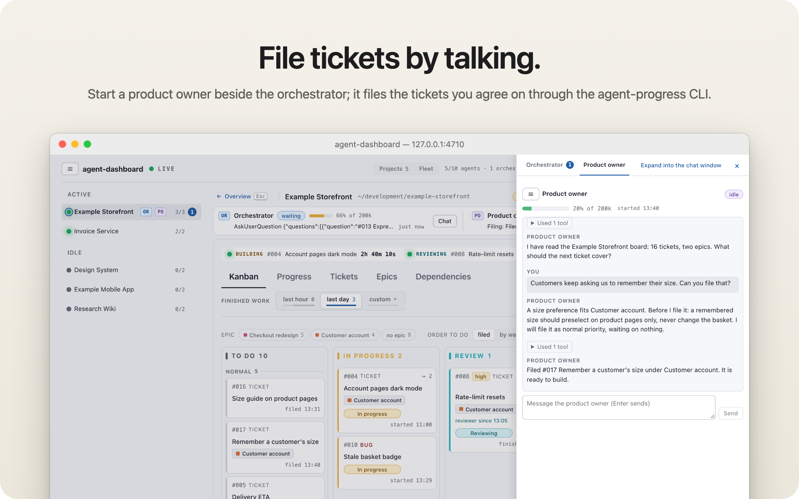
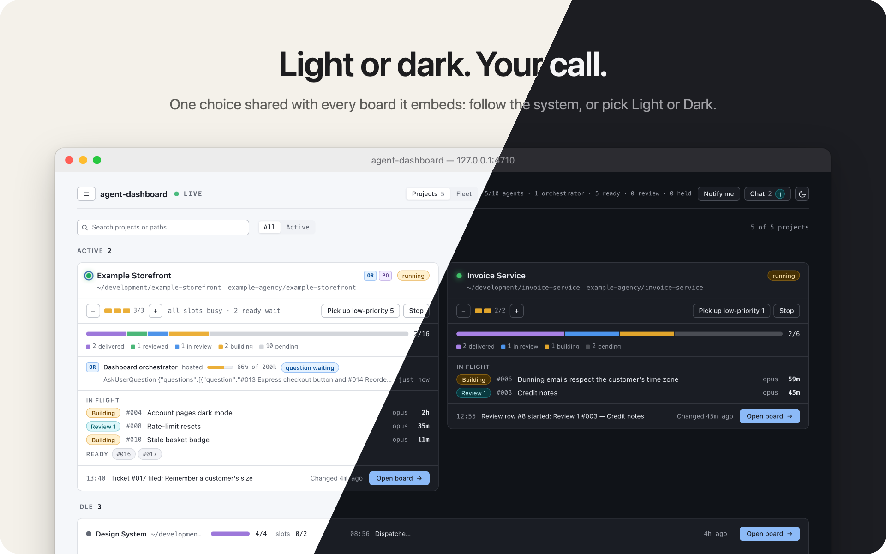
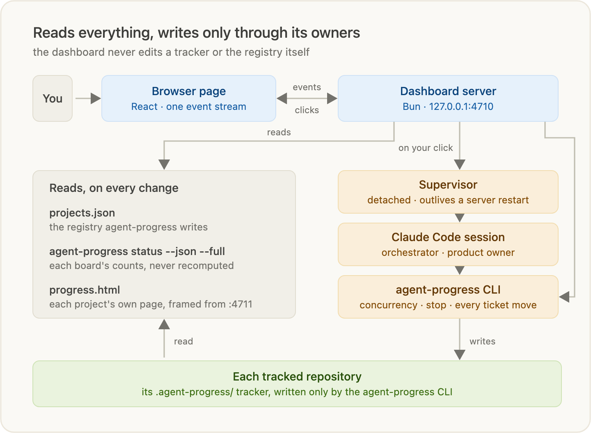
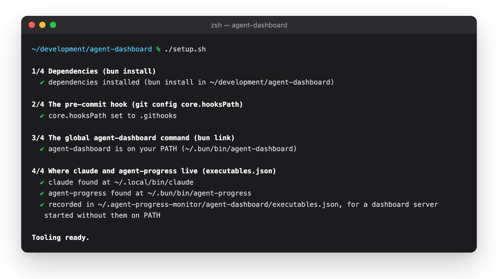
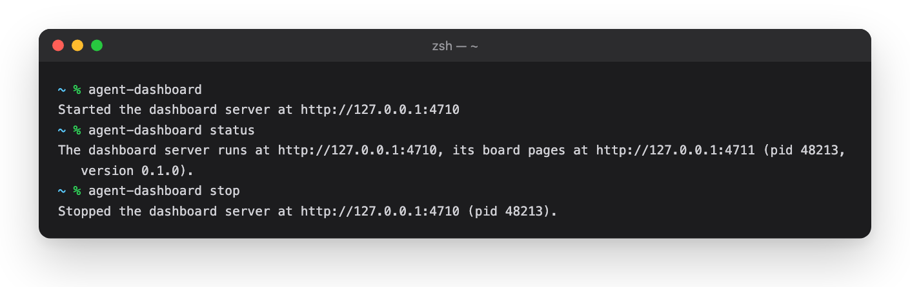

<p align="center">
  
</p>

<h1 align="center">agent-dashboard</h1>

<p align="center">
  <b>Every agent-progress board on your machine, on one page.</b><br>
  See what every project's agents are building, answer every orchestrator's questions in one chat, and start,
  stop or resize a run with one click. The boards themselves are only ever written through the agent-progress CLI.
</p>

<div align="center">
<table>
  <tr>
    <td align="center"><sub>VIEWS</sub><br><b>3</b><br><sub>projects · fleet · board</sub></td>
    <td align="center"><sub>SERVER</sub><br><b>Bun</b><br><sub>127.0.0.1 only</sub></td>
    <td align="center"><sub>RUNTIME DEPENDENCIES</sub><br><b>4</b><br><sub>React + Markdown</sub></td>
    <td align="center"><sub>TRACKER FILES IT EDITS</sub><br><b>0</b><br><sub>the CLI writes them</sub></td>
    <td align="center"><sub>SESSIONS PER PROJECT</sub><br><b>2</b><br><sub>orchestrator + product owner</sub></td>
  </tr>
</table>
</div>

<br>

<p align="center">
  
</p>

<p align="center">
  
</p>

<table>
  <tr>
    <td width="50%" valign="top">
      
    </td>
    <td width="50%" valign="top">
      
    </td>
  </tr>
  <tr>
    <td width="50%" valign="top">
      
    </td>
    <td width="50%" valign="top">
      
    </td>
  </tr>
</table>

## About

[agent-progress](https://github.com/AlexDM0/agent-progress) gives each repository a board: an orchestrator
session files tickets, a dispatcher runs builder and reviewer agents in their own worktrees, and a
self-contained `progress.html` shows every step. That works well for one repository. With four of them running
at once you are back to a row of browser tabs and terminal windows, wondering which orchestrator is waiting on
an answer.

agent-dashboard is the one page over all of them. It starts a small local server that reads the registry
agent-progress keeps of every repository it tracks, asks each board for its state, and streams it to a React page:
what is building, what is in review, what is ready, and which session needs you. Each project's own board opens
inside it. When you click, the work is done by the tools that own it: the agent-progress CLI changes a board's
slots or stops its run, and an orchestrator or product-owner session started by the dashboard writes the tracker
through that same CLI.

## Highlights

**Every project at a glance.** Active boards get a card each: slot cells, the ticket bar, the crew, up to four rows
in flight with their model and elapsed time, and the Ready, Awaiting review and Held chips. Idle boards fold into
one-line rows. The header totals agents in flight against your machine's parallel limit, live orchestrators, and the
ready, review and held counts.

**Live without polling you.** The server watches the registry and every tracker, re-reads a board through
`agent-progress status --json --full` when its files change, and pushes a snapshot down one event stream. A count
the CLI computes is taken from it, never recomputed, so the dashboard and the board can never disagree.

**Every board, framed.** Open a project and its own `progress.html` loads beside the project rail, with the theme you
picked carried into it. Above it, a command bar holds the slot stepper and the run controls that fit the dispatcher's
state: Start building, Include or Pick up low-priority tickets, Stop.

**Orchestrators you can talk to.** Start an orchestrator from the dashboard and it runs headless under a detached
supervisor that outlives a server restart. Its questions arrive in the chat window's *Waiting for you* with the
context that explains them: the tickets it mentions, its dispatcher run and the board's state. An orchestrator running
in the Claude desktop app is found through its dispatcher run and listed too, and takes your messages.

**A product owner beside it.** "+ New ticket" starts a product-owner session in the same project. It questions you
until a request is testable and files it with the `agent-po` skill, so the orchestrator's context stays on running
the board.

**Context you can see running out.** Every session shows its context meter. When an orchestrator's fills up,
*Refresh orchestrator* has it write a handoff note and starts a fresh session that reads it, instead of compacting
halfway through a run. *Open in Claude app* moves a session into the desktop app.

**It tells you when you are needed.** Opt in to browser notifications for a question asked, a run finished or
stopped, an orchestrator that ended and a context running out. Installed as a web app in Chrome or Edge, its icon
carries the number of questions waiting.

## How it works

| Piece | Runs as | Does |
|---|---|---|
| **CLI** | `agent-dashboard` | Starts or reuses the server, opens the browser, stops and restarts it. |
| **Server** | a detached Bun process on `127.0.0.1:4710` | Reads the registry and every board, serves the page and each board's folder, streams snapshots, runs the CLI on your click. |
| **Page** | React, in your browser | The Projects, Fleet and board views, the chat window and the crew drawer, on one event stream. |
| **Supervisor** | a detached process per session | Holds one headless `claude -p` session over a Unix socket, so it keeps running past a server restart. |
| **Sessions** | Claude Code | An orchestrator runs the board; a product owner files tickets. Both write through the agent-progress CLI. |
| **agent-progress** | the CLI you already have | Owns every tracker and the registry; the dashboard never writes either. |

<p align="center">
  
</p>

## Get started

### 1. Install once

You need [Bun](https://bun.sh), the [agent-progress](https://github.com/AlexDM0/agent-progress) CLI on your
`PATH`, and Claude Code for the sessions.

```sh
git clone https://github.com/AlexDM0/agent-dashboard.git && cd agent-dashboard
./setup.sh
```

<p align="center">
  
</p>

`setup.sh` installs the dependencies, links `agent-dashboard` onto your `PATH`, and records where `claude` and
`agent-progress` live, so a server started from somewhere without them on `PATH` still finds them. It changes
nothing in your tracked repositories. A `git pull` in this checkout updates it; `agent-dashboard restart` puts the
new version on the running server.

### 2. Open it

```sh
agent-dashboard
```

<p align="center">
  
</p>

Every repository agent-progress tracks shows up. agent-progress registers a repository the first time one of its
commands renders the page there; `agent-progress render` does just that.

| Command | Does |
|---|---|
| `agent-dashboard [open] [--port <n>] [--no-open]` | Reuse the running server or start one in the background, then open it in the browser and print its URL. |
| `agent-dashboard serve [--port <n>]` | Run the server in the foreground until interrupted. |
| `agent-dashboard status` | Print the running server's URL and process id, or that none runs. |
| `agent-dashboard restart [--port <n>]` | Restart the running server on its port, or start one. |
| `agent-dashboard stop` | Stop the running server. Sessions it started keep running. |

> [!TIP]
> Press <kbd>C</kbd> anywhere for the chat window and <kbd>Esc</kbd> to go from a board back to the overview.

## Privacy

<table>
  <tr>
    <td width="33%" valign="top"><b>Local only</b><br><sub>The server listens on 127.0.0.1 alone and refuses requests from other sites; starting or messaging a session takes a token only its own page can read.</sub></td>
    <td width="33%" valign="top"><b>No network</b><br><sub>The dashboard itself makes no request off your machine: no telemetry, no CDN, no web fonts. Your sessions talk to Claude as Claude Code always does.</sub></td>
    <td width="33%" valign="top"><b>Your files stay yours</b><br><sub>It reads trackers and never edits one. Its own files live in <code>~/.agent-progress-monitor/agent-dashboard/</code>.</sub></td>
  </tr>
</table>

## Information

<table>
  <tr>
    <td width="190"><b>Requires</b></td>
    <td>Bun, the agent-progress CLI, Claude Code for orchestrator and product-owner sessions</td>
  </tr>
  <tr>
    <td width="190"><b>Runs on</b></td>
    <td>built and used on macOS; <i>Open in Claude app</i> needs macOS and the Claude desktop app</td>
  </tr>
  <tr>
    <td width="190"><b>Runtime dependencies</b></td>
    <td><code>react</code>, <code>react-dom</code>, <code>react-markdown</code>, <code>remark-gfm</code></td>
  </tr>
  <tr>
    <td width="190"><b>Reads</b></td>
    <td><code>~/.agent-progress-monitor/projects.json</code>, <code>agent-progress status --json --full</code> per project, each project's <code>progress.html</code>, and <code>~/.claude/</code> to find desktop-app orchestrators</td>
  </tr>
  <tr>
    <td width="190"><b>Ports</b></td>
    <td>4710 for the dashboard and 4711 for the board pages it frames; <code>--port</code> moves both</td>
  </tr>
  <tr>
    <td width="190"><b>Source</b></td>
    <td><a href="https://github.com/AlexDM0/agent-dashboard">github.com/AlexDM0/agent-dashboard</a></td>
  </tr>
</table>

## Further reading

- **[Design](docs/design.md)**: the specification: sources of truth, the server and its routes, the orchestrator
  sessions and their supervisor, and every view in detail.
- **[README graphics](.readme-graphics/README.md)**: how every image above is generated from this checkout's own
  server, over a synthetic machine, with one command.
